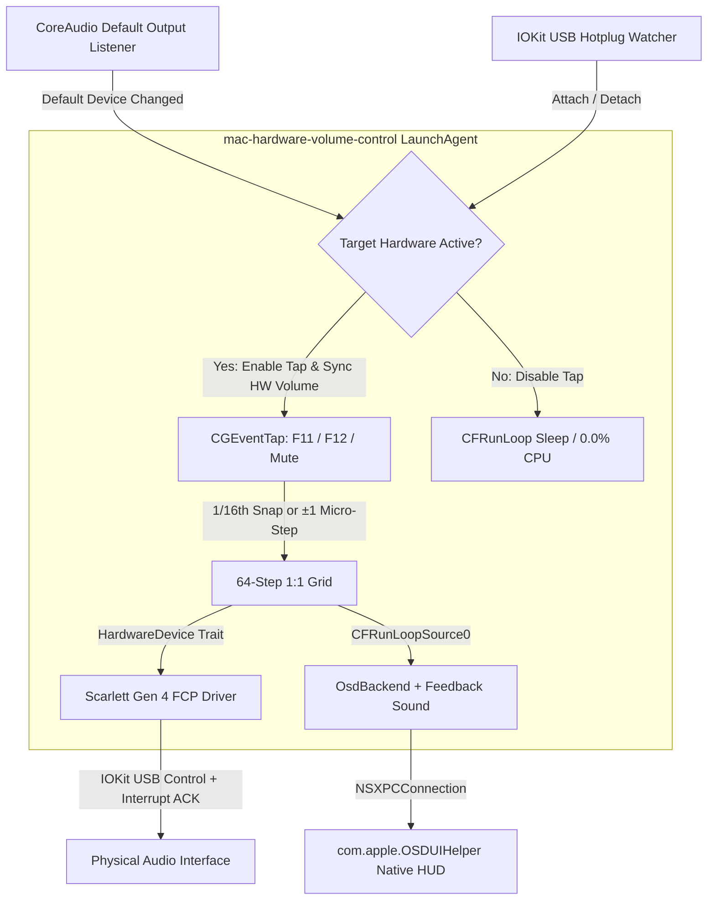

# mac-hardware-volume-control

A lightweight, native macOS `launchd` daemon written in Rust that binds your Mac's media keys (`F11` / `F12` / `Mute` and `Option+Shift+F11/F12`) directly to your USB audio interface's hardware monitor volume — and renders the native macOS On-Screen Display (HUD) with system volume feedback sound.

> **Supported Hardware Scope:** Designed exclusively for audio interfaces with **digital monitor volume controls** (such as the Focusrite Scarlett 4th Gen). Interfaces with **analog monitor potentiometers** (such as the Scarlett 3rd Gen 2i2) are unsupported.

You select your physical interface directly in **macOS Sound Settings** and **Logic Pro**. No virtual CoreAudio HAL devices, no Aggregate/Multi-Output devices, no audio taps, and zero microphone permissions.

## Problem Statement

macOS disables native keyboard volume control (`F11` / `F12` / `Mute`) for class-compliant USB audio interfaces because hardware monitor gain is controlled out-of-band over USB rather than via CoreAudio software attenuation.

Common workarounds introduce trade-offs:

1. **Virtual CoreAudio HAL / Ring-Buffer Drivers:** Add buffer latency, risk sample-rate mismatches in Logic Pro, and duplicate output devices.
2. **Aggregate / Multi-Output Devices:** macOS disables hardware volume keys on Aggregate and Multi-Output devices.
3. **User-Space Audio Taps:** Trigger the macOS microphone privacy indicator.
4. **Custom HUD Overlays:** Diverge from native macOS styling and behavior.

`mac-hardware-volume-control` intercepts media keys via `CGEventTap` **only** when your target interface is the active CoreAudio default output device, writes directly to the hardware monitor level over USB, and triggers the native `OSDUIHelper` HUD and `AudioServicesPlaySystemSound` feedback sound (output-only, no microphone permission).

## Volume Mapping (64-Step 1:1 Linear Grid)

- **Grid:** `0..=64` discrete steps.
- **Standard Press (`F11` / `F12`):** Steps to the next/previous `1/16`th tick (multiple of `4`; snaps to the nearest `1/16`th in the press direction when starting from an intermediate micro-step).
- **Micro-Step (`Option + Shift + F11 / F12`):** `±1` step (64 fine steps).
- **1:1 LED Ring Match:** Maps the 64-step grid to the Scarlett Gen 4 hardware monitor level (`-127..=0` dB) using a perceptual taper so `25%`, `50%`, and `100%` align 1:1 with the physical LED ring (`0%` = Mute).
- **Jump-Free Connect:** Reads the current hardware monitor level and mute state on startup, USB hotplug, or output switch before applying any key delta.

## Installation

### Prerequisites

- **macOS:** macOS 11+ (tested on macOS 26/27 Tahoe).
- **Architecture:** Apple Silicon (`aarch64-apple-darwin`) or Intel (`x86_64-apple-darwin`).
- **Toolchain:** [Rust & Cargo](https://www.rust-lang.org/tools/install) (Edition 2021+).
- **Permission:** Accessibility permission only (`CGEventTap`).

### Setup Steps

1. Clone the repository and run the installer:
   ```bash
   git clone https://github.com/eamq/mac-hardware-volume-control.git
   cd mac-hardware-volume-control
   ./scripts/install.sh
   ```
   To specify a device ID explicitly instead of auto-detecting:
   ```bash
   ./scripts/install.sh --device scarlett-gen4
   ```
2. Grant **Accessibility** permission to `/usr/local/bin/mac-hardware-volume-control` in **System Settings → Privacy & Security → Accessibility** when prompted.
3. Wait ~2 seconds — the daemon detects the permission and activates automatically without a restart.

## Service Management & Verification

- **Check Status:**
  ```bash
  mac-hardware-volume-control --status
  launchctl list | grep mac-hardware-volume-control
  ```
- **Detect Connected Hardware:**
  ```bash
  mac-hardware-volume-control --detect
  ```
- **Test OSD HUD:**
  ```bash
  mac-hardware-volume-control --test-osd 32
  ```
- **Stop Daemon:**
  `KeepAlive` is enabled, so `launchctl stop` will immediately respawn the process. Use `bootout` to stop it:
  ```bash
  launchctl bootout "gui/$(id -u)/com.user.mac-hardware-volume-control"
  ```
- **View Logs:**
  ```bash
  cat /tmp/mac-hardware-volume-control.log
  cat /tmp/mac-hardware-volume-control.err
  ```
- **Run Lint & Test Suite:**
  ```bash
  cargo fmt -- --check
  cargo clippy --all-targets -- -D warnings
  cargo test --release
  shellcheck scripts/*.sh
  bats tests/scripts.bats
  ```

## Uninstall

Run the uninstall script from the repository root to unload the `launchd` agent and remove the installed binary, plist, and config:

```bash
./scripts/uninstall.sh
```

## Known Limitations

- **No Liquid Glass HUD (macOS 26/27 Tahoe):** Uses the native `com.apple.OSDUIHelper` square bezel HUD. Tahoe's Liquid Glass banner (`SystemBannerService`) is entitlement-gated and silently ignores unentitled XPC calls.
- **No Menu Bar / Control Center Volume Slider:** Only hardware media keys (`F11` / `F12` / `Mute` and `Option+Shift+F11/F12`) are handled.
- **Digital Monitor Volume Only:** Interfaces with analog monitor potentiometers (e.g., Scarlett 3rd Gen 2i2) are unsupported.
- **Exclusive USB Interface Access:** Vendor control apps (such as Focusrite Control 2) cannot hold the vendor USB interface at the same time; close them so the daemon can claim it.
- **Rebuilding Invalidates Accessibility:** Reinstalling a newly compiled binary changes its Mach-O CDHash. If keys stop responding after a rebuild, remove (`-`) and re-add (`+`) `/usr/local/bin/mac-hardware-volume-control` in **System Settings → Privacy & Security → Accessibility**.

## Architecture & Extensibility



### Module Layout (`src/`)

- `src/volume.rs` — 64-step `VolumeState` grid (`1/16`th snapping on standard presses, `±1` micro-step, 1:1 linear mapping)
- `src/config.rs` — `~/.config/mac-hardware-volume-control/config.json` loader
- `src/main.rs` — CLI (`--detect`, `--status`, `--list-devices`, `--test-osd`, `--probe-usb`, `--probe-fcp`) and `CFRunLoop` daemon
- `src/devices/`
  - `mod.rs` — `HardwareDevice` trait and `DeviceRegistry`
  - `scarlett_gen4.rs` — Scarlett 4th Gen driver and perceptual dB taper
  - `fcp.rs` — Focusrite Control Protocol over `IOKit`
  - `iokit_usb.rs` — Read-only `IOUSBLib` interface probe
  - `usb_probe.rs` — `ioreg` USB VID/PID discovery
- `src/osd/`
  - `mod.rs` — `OsdBackend` trait and `MacOsVersion` runtime dispatcher
  - `osd_framework.rs` — `com.apple.OSDUIHelper` XPC bridge (with `OSDManager` fallback)
  - `macos_liquid_glass.rs` — Tahoe dispatch wrapper
  - `noop.rs` — Headless/fallback backend
- `src/platform/`
  - `coreaudio.rs` — Default output device listener
  - `iokit_hotplug.rs` — USB attach/detach watcher
  - `media_keys.rs` — `CGEventTap` and Accessibility trust check
  - `feedback_sound.rs` — System volume feedback via `AudioServicesPlaySystemSound`

### Adding a New Hardware Device

1. Create `src/devices/<device>.rs` implementing `HardwareDevice` (`id`, `display_name`, `coreaudio_name_hints`, and `usb_ids`).
2. Register it in `src/devices/mod.rs` inside `default_registry()`.

### Adding a New macOS OSD Backend

1. Create `src/osd/<backend>.rs` implementing `OsdBackend`.
2. Register it in `src/osd/mod.rs` inside `select_backend()`.
