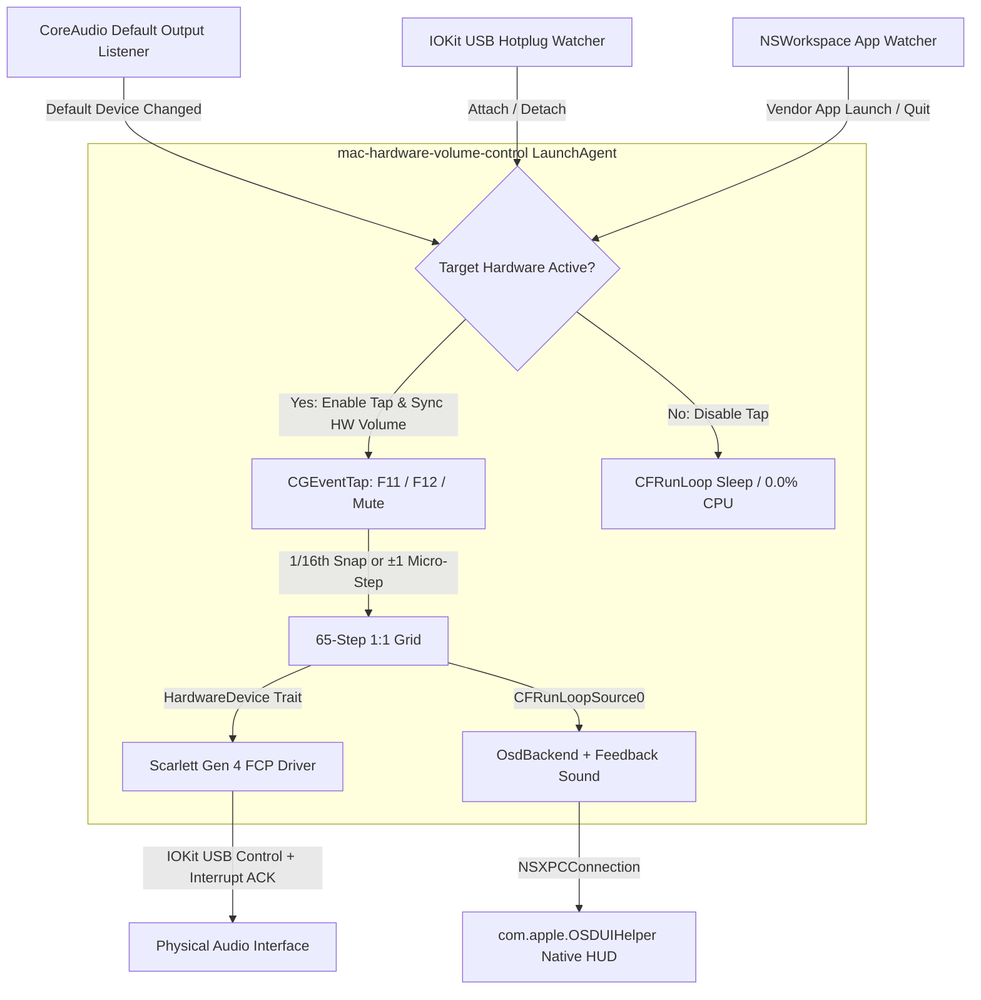

# mac-hardware-volume-control

A lightweight, native macOS `launchd` daemon written in Rust that binds your Mac's media keys (`F11` / `F12` / `Mute` and `Option+Shift+F11/F12`) directly to your USB audio interface's hardware monitor volume — and renders the native macOS On-Screen Display (HUD) with system volume feedback sound.

> **Supported Hardware Scope:** Designed exclusively for audio interfaces with **digital monitor volume controls** (such as the Focusrite Scarlett 4th Gen). Interfaces with **analog monitor potentiometers** (such as the Scarlett 3rd Gen 2i2) are unsupported.

You select your physical interface directly in **macOS Sound Settings** and **Logic Pro**. No virtual CoreAudio HAL devices, no Aggregate/Multi-Output devices, no audio taps, and zero microphone permissions.

## Problem Statement

macOS disables native keyboard volume control (`F11` / `F12` / `Mute`) for class-compliant USB audio interfaces because hardware monitor gain is controlled out-of-band over USB rather than via CoreAudio software attenuation.

Common workarounds introduce trade-offs:

1. **Virtual CoreAudio HAL / Ring-Buffer Drivers:** Add buffer latency, risk sample-rate mismatches in Logic Pro, and duplicate output devices.
2. **Aggregate / Multi-Output Devices:** macOS disables hardware volume keys on Aggregate and Multi-Output devices.
3. **User-Space Audio Taps:** Trigger the macOS microphone privacy indicator.
4. **Custom HUD Overlays:** Draw bespoke overlay windows instead of invoking macOS's native OSD service.

`mac-hardware-volume-control` intercepts media keys via `CGEventTap` **only** when your target interface is the active CoreAudio default output device, writes directly to the hardware monitor level over USB, and triggers the native `OSDUIHelper` HUD and `AudioServicesPlaySystemSound` feedback sound (output-only, no microphone permission).

## Installation

### Prerequisites

- **macOS:** macOS 11+ (tested on macOS 15 in CI and macOS 27).
- **Architecture:** Apple Silicon (`aarch64-apple-darwin`) or Intel (`x86_64-apple-darwin`).
- **Toolchain:** [Rust & Cargo](https://www.rust-lang.org/tools/install) (Edition 2021+).
- **Permission:** Device Control and Data Access permission only (Accessibility on macOS 26 and earlier) for `CGEventTap`.

### Setup Steps

1. Clone the repository and run the installer:
   ```bash
   git clone https://github.com/eamq/mac-hardware-volume-control.git
   cd mac-hardware-volume-control
   ./scripts/install.sh
   ```
2. Grant **Device Control and Data Access** permission to `/usr/local/bin/mac-hardware-volume-control` in **System Settings → Privacy & Security → Device Control and Data Access** (**Accessibility** on macOS 26 and earlier) when prompted (activates automatically within ~2 seconds).

## CLI & Service Management

```bash
mac-hardware-volume-control --start   # Start the LaunchAgent daemon
mac-hardware-volume-control --stop    # Stop the LaunchAgent daemon
mac-hardware-volume-control --status  # Show active output, macOS version, and OSD backend
mac-hardware-volume-control --help    # List all CLI flags
```

- **View Logs:**
  ```bash
  cat /tmp/mac-hardware-volume-control.log
  cat /tmp/mac-hardware-volume-control.err
  ```
- **Run Lint & Test Suite:**
  ```bash
  cargo clippy --all-targets -- -D warnings
  cargo test --release
  shellcheck scripts/*.sh
  bats tests/scripts.bats
  ```

## Uninstall

Run the uninstall script from the repository root to unload the `launchd` agent and remove the installed binary, plist, config, and self-signed keychain certificate:

```bash
./scripts/uninstall.sh
```

Afterwards, remove `mac-hardware-volume-control` from **System Settings → Privacy & Security → Device Control and Data Access** (**Accessibility** on macOS 26 and earlier).

## Known Limitations

- **No Liquid Glass HUD (macOS 26/27 Tahoe):** Uses the native `com.apple.OSDUIHelper` square bezel HUD. Tahoe's Liquid Glass banner (`SystemBannerService`) is entitlement-gated and silently ignores unentitled XPC calls.
- **No Menu Bar / Control Center Volume Slider:** Only hardware media keys (`F11` / `F12` / `Mute` and `Option+Shift+F11/F12`) are handled.
- **Digital Monitor Volume Only:** Interfaces with analog monitor potentiometers (e.g., Scarlett 3rd Gen 2i2) are unsupported.
- **Exclusive USB Interface Access:** macOS cannot grant USB interface access to multiple applications at once, meaning `F11` / `F12` / `Mute` won't adjust hardware volume while a USB interface vendor app is open. For headless/iPad remote-control servers (such as `FocusriteControlServer`), use `mac-hardware-volume-control --stop` and `--start`. **Note:** this limitation does not apply to interfaces/devices that connect over Thunderbolt or EUCON.

## Volume Mapping (65-Step 1:1 Linear Grid)

- **Grid:** 65 discrete steps (`0-64`, where `0` = muted and `64` = 100%).
- **Standard Press (`F11` / `F12`):** Steps to the next/previous `1/16`th tick (multiple of `4`; snaps to the nearest `1/16`th in the press direction when starting from an intermediate micro-step).
- **Micro-Step (`Option + Shift + F11 / F12`):** `±1` step.
- **1:1 LED Ring Match:** Maps the grid via a perceptual taper so `25%`, `50%`, and `100%` align with the hardware LED ring (`0%` = Mute).
- **Jump-Free Connect:** Reads the current hardware monitor level and mute state on startup, USB hotplug, or output switch before applying any key delta.

## Architecture & Extensibility



### Module Layout (`src/`)

- `src/main.rs` — Thin binary entrypoint
- `src/cli.rs` — CLI flag parsing (`--start`, `--stop`, `--status`, etc.) and one-shot commands
- `src/daemon.rs` — `CFRunLoop` daemon, state machine, and hardware/app-handoff coordination
- `src/volume.rs` — 65-step `VolumeState` grid (`1/16`th snapping on standard presses, `±1` micro-step, 1:1 linear mapping)
- `src/config.rs` — `~/.config/mac-hardware-volume-control/config.json` loader
- `src/devices/`
  - `mod.rs` — `HardwareDevice` trait and `DeviceRegistry`
  - `scarlett_gen4.rs` — Scarlett 4th Gen driver and perceptual dB taper
  - `fcp.rs` — Focusrite Control Protocol over `IOKit`
  - `iokit_usb.rs` — Read-only `IOUSBLib` interface probe
  - `usb_probe.rs` — `ioreg` USB VID/PID discovery
- `src/osd/`
  - `mod.rs` — `OsdBackend` trait and `MacOsVersion` runtime dispatcher
  - `osd_framework.rs` — `com.apple.OSDUIHelper` XPC bridge (with `OSDManager` fallback)
  - `macos_liquid_glass.rs` — Tahoe dispatch wrapper
  - `noop.rs` — Headless/fallback backend
- `src/platform/`
  - `app_watcher.rs` — `NSWorkspace` launch/terminate observer for conflicting vendor apps
  - `coreaudio.rs` — Default output device listener
  - `iokit_hotplug.rs` — USB attach/detach watcher
  - `media_keys.rs` — `CGEventTap` and Accessibility trust check
  - `feedback_sound.rs` — System volume feedback via `AudioServicesPlaySystemSound`

### Adding a New Hardware Device

1. Create `src/devices/<device>.rs` implementing `HardwareDevice` (`id`, `display_name`, `coreaudio_name_hints`, `usb_ids`, and optionally `conflicting_app_prefixes`).
2. Register it in `src/devices/mod.rs` inside `default_registry()`.

### Adding a New macOS OSD Backend

1. Create `src/osd/<backend>.rs` implementing `OsdBackend`.
2. Register it in `src/osd/mod.rs` inside `select_backend()`.

### Code Signing & Permission Persistence

`scripts/install.sh` automatically creates and trusts a self-signed `mac-hardware-volume-control` Code Signing certificate in your login keychain on first run (`openssl` + `security`), then signs the installed binary on every build (`--codesign` to override). This keeps your **Device Control and Data Access** (**Accessibility** on macOS 26 and earlier) grant valid across rebuilds without an Apple Developer account.

### Why `OSDUIHelper` Instead of Liquid Glass?

macOS Tahoe's Liquid Glass HUD (`SystemBannerService` in `ControlCenter.app`) requires **Apple-internal private entitlements** that are not available to third-party developers—even with a paid Apple Developer account (AMFI rejects self-claimed private entitlements at launch). Synthetic `NSSystemDefined` media-key passthrough also doesn't render a HUD when the default output is a class-compliant USB audio interface without CoreAudio volume control. `com.apple.OSDUIHelper` is therefore the only genuine native Apple HUD reachable without drawing a custom `NSWindow` overlay.
